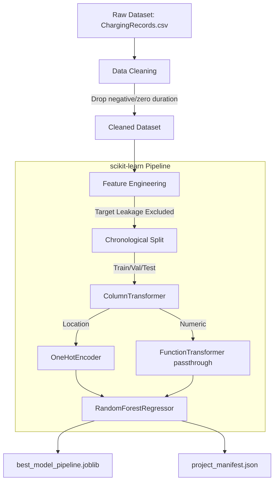
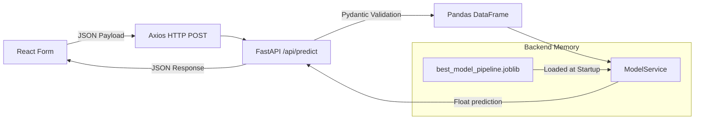
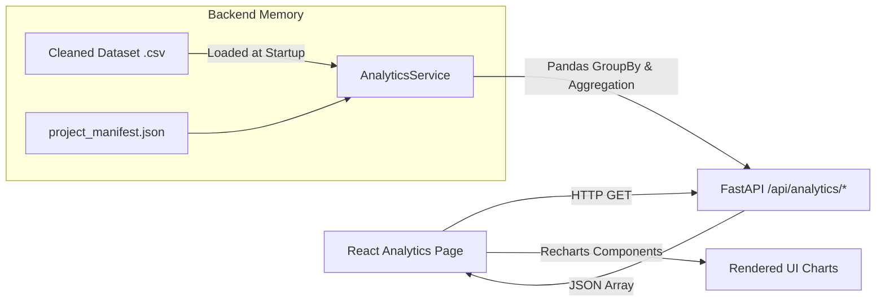

# System Architecture

This document maps the data flow and integration architecture across the three tiers of the EV Charging Demand project.

## 1. Machine Learning Pipeline Architecture

## 2. Inference Architecture

## 3. Analytics Architecture

## Architectural Design Decisions
1. **No Database:** Due to the static nature of the historical dataset, analytics are processed dynamically in memory using `pandas` rather than deploying an unnecessary relational database.
2. **Model Caching:** The `.joblib` model is deserialized into memory once during the Uvicorn application startup event. This prevents repeated disk I/O and deserialization penalties on every API request.
3. **Strict Boundaries:** The FastAPI layer acts strictly as a validation and communication bridge. It does not perform internal feature engineering. The `joblib` pipeline contains the mathematical transformations.
